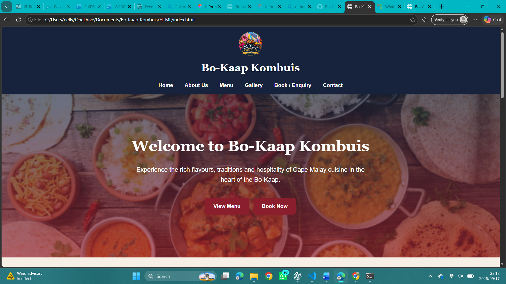
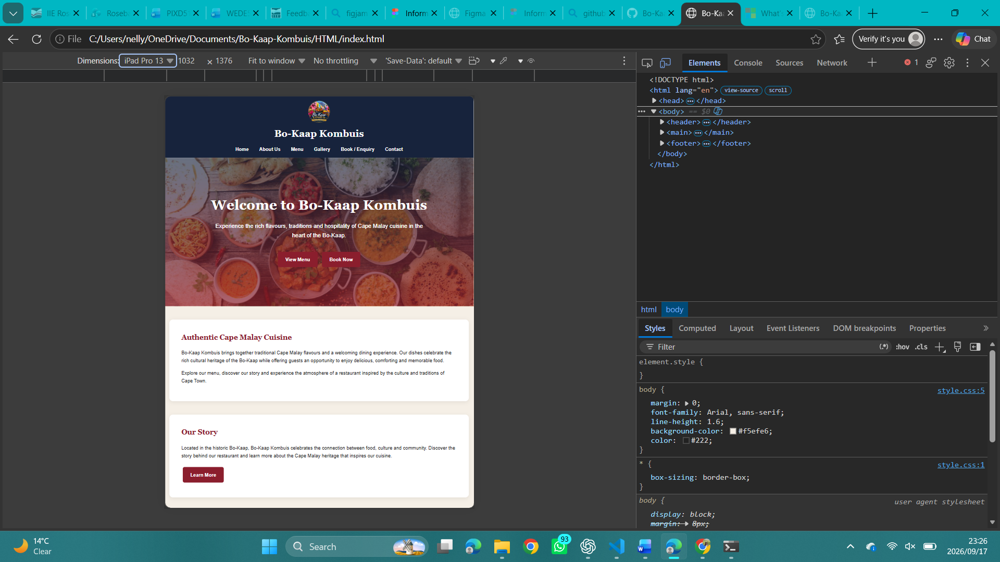
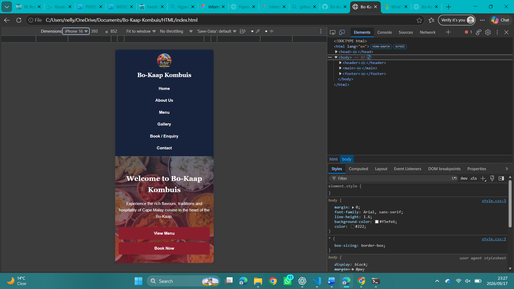

# Bo-Kaap Kombuis

## Student Information

* **Student Number:** ST10533474
* **Student Name:** Nelly Mgijima
* **Project:** Bo-Kaap Kombuis Website
* **Course:** Web Development
* **Project Type:** Restaurant Website
* **Development Tools:** Visual Studio Code, Git and GitHub

---

## Project Overview

Bo-Kaap Kombuis is a restaurant website project designed to showcase Cape Malay cuisine and the cultural heritage of the Bo-Kaap. The website provides visitors with information about the restaurant, its menu, food, cultural atmosphere, booking options, enquiries and contact details.

The website was developed as a multi-page website using HTML5, CSS3 and JavaScript. Git and GitHub were used for version control and project submission.

## Website Purpose

The purpose of the website is to provide Bo-Kaap Kombuis with an informative, attractive and user-friendly online presence.

The website allows visitors to:

* Learn about Bo-Kaap Kombuis and its cultural background.
* View information about Cape Malay cuisine and menu options.
* Explore photographs of food and the restaurant.
* Submit a booking request.
* Send an enquiry or general message.
* Find the restaurant's contact information.
* Navigate between the different sections of the website.

## Goals and Objectives

### Goals

The main goal of the project is to create a professional restaurant website that communicates the identity of Bo-Kaap Kombuis while providing visitors with useful information and simple navigation.

The website aims to:

* Present Bo-Kaap Kombuis in a professional and visually appealing way.
* Highlight Cape Malay food and the cultural heritage of the Bo-Kaap.
* Provide visitors with clear information about the restaurant.
* Make important information such as the menu, booking and contact details easy to find.
* Provide a responsive website that can be viewed on desktop, tablet and mobile devices.

### Objectives

The project objectives are to:

1. Develop a multi-page website using HTML5.
2. Create a consistent visual design using an external CSS stylesheet.
3. Use CSS Grid and Flexbox to create structured page layouts.
4. Apply appropriate typography, colours, spacing and visual styling.
5. Add interactive elements using JavaScript.
6. Create booking, enquiry and contact forms with validation.
7. Implement responsive design for different screen sizes.
8. Organise images and project files into appropriate folders.
9. Use Git and GitHub for version control.
10. Maintain a detailed README and changelog documenting the development process.
11. Apply search engine optimisation techniques to improve the website's structure and visibility.

## Website Pages

The website consists of the following pages:

### Home

Introduces Bo-Kaap Kombuis and highlights the restaurant experience, Cape Malay cuisine and links to other sections of the website.

### About Us

Provides information about the restaurant, its cultural connection to the Bo-Kaap and its Cape Malay heritage.

### Menu

Displays Cape Malay food and menu options available at the restaurant. JavaScript category filters and search functionality allow visitors to find menu items.

### Gallery

Showcases food, restaurant and cultural images. A lightbox feature allows visitors to view gallery images in a larger format and navigate between images.

### Booking

Allows visitors to submit a booking request through an online form with input validation.

### Enquiry

Allows visitors to submit questions or enquiries about the restaurant using a validated enquiry form.

### Contact

Provides restaurant contact information, an interactive map, directions and a form for visitors to send general messages.

## Technologies Used

### HTML5

HTML5 is used to create the structure and content of the website pages, including navigation, images, forms and other page elements.

### CSS3

CSS3 is used for:

* Page styling.
* Colours and typography.
* Spacing and layouts.
* Navigation styling.
* Responsive design.
* Interactive visual effects.
* Image presentation.

### JavaScript

JavaScript is used to provide interactive functionality, including:

* Responsive mobile navigation.
* Menu category filtering and search.
* Gallery lightbox functionality.
* Form validation.
* Form submission and confirmation messages.
* Preparation of email messages through mailto links.

### Git

Git is used for local version control and to keep track of changes made during development.

### GitHub

GitHub is used to store the project repository remotely and provide version control for the project.

### Netlify

Netlify is used to deploy the website and host the live version. Netlify Forms is integrated with the enquiry and contact forms to receive form submissions.

## Project Structure

```text
Bo-Kaap-Kombuis/
│
├── HTML/
│   ├── about.html
│   ├── booking.html
│   ├── contact.html
│   ├── enquiry.html
│   ├── gallery.html
│   ├── index.html
│   └── menu.html
│
├── CSS/
│   └── style.css
│
├── Images/
│   ├── food/
│   ├── gallery/
│   ├── logo/
│   └── restaurant/
│
├── JS/
│   └── script.js
│
├── Screenshots/
│
├── README.md
├── robots.txt
├── sitemap.xml
└── _redirects
```

## Website Functionality

The website includes several interactive features to improve usability and visitor experience.

### Responsive Navigation

A JavaScript-powered hamburger menu allows visitors to navigate the website on smaller screens.

### Menu Search and Filtering

Visitors can search for menu items and filter available items according to their categories.

### Gallery Lightbox

The gallery includes a lightbox that displays selected images in a larger format. Visitors can navigate between images and close the lightbox.

### Interactive Map

The contact page includes an embedded Google Maps display showing the restaurant's location, together with a directions link.

### Form Validation

JavaScript and HTML5 validation are used to check that visitors provide the required information before submitting forms.

## Forms and Functionality

The website includes three forms:

* **Booking form:** Allows visitors to submit booking requests.
* **Enquiry form:** Allows visitors to submit questions or enquiries.
* **Contact form:** Allows visitors to send general messages, feedback and other contact requests.

The forms use required fields and validation to help ensure that visitors provide the necessary information.

The enquiry and contact forms use Netlify Forms with AJAX submission. Successful submissions are stored through Netlify and confirmation messages are displayed to visitors.

The contact and enquiry email preparation functionality also uses mailto links to create an email containing the visitor's submitted information. Visitors must open their email application and send the prepared email themselves. The email is not sent automatically.

## SEO and Website Accessibility

Search engine optimisation improvements include:

* Descriptive page titles.
* Meta descriptions on website pages.
* Meta keywords on website pages.
* Structured heading elements.
* Descriptive image filenames.
* Alternative text for images.
* Internal links between website pages.
* Responsive layouts for mobile devices.
* Optimised WebP images.
* A `robots.txt` file.
* A `sitemap.xml` file.

The website also uses descriptive labels for form fields and alternative text for images to improve accessibility.

## Responsive Design Evidence

The website was tested at desktop, tablet and mobile screen sizes using browser developer tools. The layout, navigation, images, text and content were checked to ensure that the website remains readable and usable across different screen sizes.

### Desktop View



### Tablet View



### Mobile View



## Deployment

The website was deployed using Netlify.

**Live Website:** https://timely-croquembouche-449dde.netlify.app/

**GitHub Repository:** https://github.com/ST10533474/Bo-Kaap-Kombuis

The GitHub repository is connected to Netlify, allowing updates pushed to the main branch to trigger new deployments.

## Testing

The website was tested to check that its pages, forms and interactive features work correctly.

Testing included:

* Checking navigation links across website pages.
* Testing the responsive hamburger menu.
* Testing menu search and category filtering.
* Testing gallery lightbox functionality.
* Testing booking form validation.
* Testing enquiry form validation and submission.
* Testing contact form validation and submission.
* Confirming that enquiry and contact test submissions appear in Netlify Forms.
* Checking that the contact form displays its confirmation message.
* Testing the prepared email link.
* Checking the website on desktop, tablet and mobile screen sizes.

## Changelog

### Part 2 – CSS Styling and Responsive Design

* Improved the overall website styling using an external CSS stylesheet.
* Updated the homepage hero section with a Cape Malay food image and improved text readability.
* Improved the navigation layout, spacing and hover effects.
* Added responsive navigation for smaller screen sizes.
* Improved button styling and interactive hover effects.
* Added focus styling for form fields and navigation links.
* Improved the layout and appearance of content sections using spacing, borders and shadows.
* Improved the gallery layout with responsive grid columns.
* Added responsive image sizing for different screen sizes.
* Improved booking and contact form styling.
* Added mobile and tablet breakpoints to improve usability on smaller screen sizes.
* Tested the website across desktop, tablet and mobile screen sizes using browser developer tools.
* Added desktop, tablet and mobile screenshot evidence to document responsive testing.
* Converted selected food images to WebP format to reduce image file sizes.
* Converted responsive gallery images to WebP format.
* Updated relevant HTML image paths to use the optimised images.
* Added lazy loading and asynchronous image decoding to gallery images.
* Updated the homepage hero background image to use the optimised WebP image.

### Part 3 – Enhancing Functionality and SEO

* Implemented JavaScript interactivity to improve the website's functionality and user experience.
* Added a responsive hamburger navigation menu for mobile devices.
* Added dynamic menu search and category filtering.
* Implemented a gallery lightbox with image navigation.
* Added JavaScript validation to the booking, enquiry and contact forms.
* Added an enquiry page with form fields and input validation.
* Added a contact form with fields for visitor details, message type and message content.
* Integrated Netlify Forms with AJAX submission for the enquiry and contact forms.
* Enabled Netlify form detection and confirmed that both forms successfully receive test submissions.
* Added email preparation functionality using mailto links.
* Improved form usability through validation and confirmation feedback.
* Improved search engine optimisation through page titles, meta descriptions, meta keywords, heading structure, descriptive image filenames and alternative text.
* Added and updated `robots.txt` and `sitemap.xml`.
* Deployed the website using Netlify.
* Tested the website's functionality and responsiveness on the live deployment.
* Updated the contact form email link to improve local testing and live website functionality.

## References

Google (n.d.) *Google Maps*. Available at: https://www.google.com/maps (Accessed: 2 November 2026).

MDN Web Docs (n.d.) *CSS flexible box layout*. Available at: https://developer.mozilla.org/en-US/docs/Web/CSS/Guides/Flexible_box_layout (Accessed: 2 November 2026).

MDN Web Docs (n.d.) *Media queries*. Available at: https://developer.mozilla.org/en-US/docs/Web/CSS/Guides/Media_queries (Accessed: 2 November 2026).

MDN Web Docs (n.d.) *Responsive web design*. Available at: https://developer.mozilla.org/en-US/docs/Learn_web_development/Core/CSS_layout/Responsive_Design (Accessed: 2 November 2026).

MDN Web Docs (n.d.) *Responsive images*. Available at: https://developer.mozilla.org/en-US/docs/Web/HTML/Guides/Responsive_images (Accessed: 2 November 2026).

MDN Web Docs (n.d.) *HTML forms*. Available at: https://developer.mozilla.org/en-US/docs/Learn_web_development/Extensions/Forms (Accessed: 2 November 2026).

MDN Web Docs (n.d.) *JavaScript*. Available at: https://developer.mozilla.org/en-US/docs/Web/JavaScript (Accessed: 2 November 2026).

Netlify (n.d.) *Forms setup*. Available at: https://docs.netlify.com/manage/forms/setup/ (Accessed: 2 November 2026).

Netlify (n.d.) *Deploy with Git*. Available at: https://docs.netlify.com/site-deploys/create-deploys/ (Accessed: 2 November 2026).
